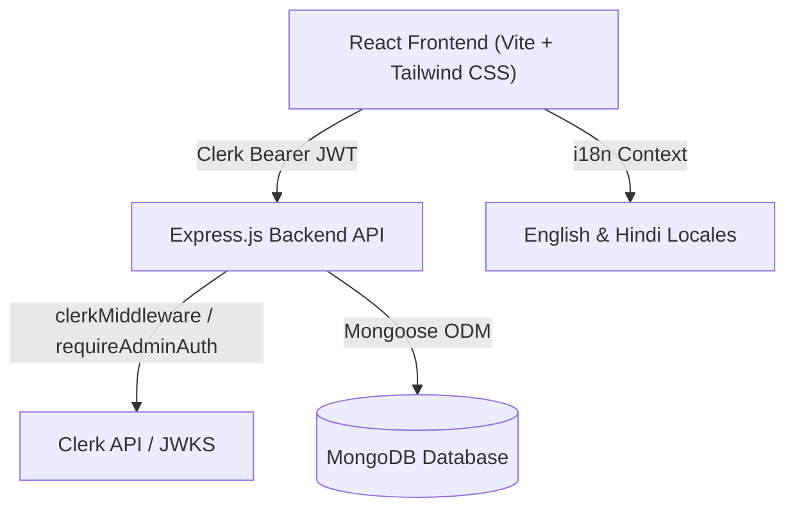

# Customer Account Ledger (ग्राहक खाता बही)

A production-ready customer account and financial ledger management web application built with the **MERN Stack** (MongoDB, Express.js, React, Node.js) and authenticated with **Clerk**.

The application is designed specifically for business administrators to track customer credits, payments (debits), and outstanding balances. It features complete bilingual support in **English** and **Hindi (हिन्दी)** throughout the user interface, with English as the default language and an instant language switcher accessible on every screen.

---

## Table of Contents

1. [Features](#features)
2. [Architecture & Tech Stack](#architecture--tech-stack)
3. [Prerequisites](#prerequisites)
4. [Project Structure](#project-structure)
5. [Environment Configuration](#environment-configuration)
6. [Clerk Setup & Admin Authorization](#clerk-setup--admin-authorization)
7. [MongoDB Configuration](#mongodb-configuration)
8. [Installation & Running](#installation--running)
9. [Automated Testing](#automated-testing)
10. [API Documentation](#api-documentation)
11. [Ledger Business Rules & Zero-Balance Removal](#ledger-business-rules--zero-balance-removal)
12. [Bilingual English & Hindi Localization](#bilingual-english--hindi-localization)
13. [Demo Data Seeding](#demo-data-seeding)

---

## Features

- **Strict Admin-Only Access**: Entirely private application protected on both frontend and backend using Clerk. Non-admin users receive HTTP `403 Forbidden` and a bilingual Access Denied screen.
- **Bilingual Interface (English & Hindi)**:
  - English is default with an instant language switcher (`EN` / `हिन्दी`) in navigation and modals.
  - Complete translation of navigation, headers, stat cards, table columns, form labels, tooltips, validation messages, confirmation dialogs, toasts, and empty states.
  - **Preserves customer data**: Customer names, addresses, notes, and user-entered text remain exactly as entered.
- **Customer Account Management**:
  - Add customers with name, address, and phone number.
  - Normalizes phone numbers to standard E.164 (e.g. `+919876543210`) as unique account identifiers.
  - Uniqueness enforced via MongoDB unique indexes and server-side validation.
  - Phone numbers are permanently locked in the edit form to maintain financial ledger auditability.
  - Search by customer name, phone number, or address.
  - Server-side sorting by Balance (high/low), Name (A-Z/Z-A), Address (A-Z/Z-A), or Recent Activity.
- **Financial Ledger & Integer Minor Units**:
  - All monetary values are calculated and stored in **minor units** (paise) on the server to prevent floating-point rounding inaccuracies.
  - Balance is calculated on the server from transaction records as $\sum \text{Credits} - \sum \text{Debits}$.
  - Debits that exceed the current outstanding balance are strictly rejected.
  - Configurable currency setting (default INR `₹`).
- **Atomic Zero-Balance Removal / Archival**:
  - **Default Behavior**: When a payment (debit) brings an account balance to exactly zero (`₹0.00`), the customer account and its transaction history are atomically deleted.
  - **Configurable Archive Mode**: Business owners can toggle the system setting to `archive` mode instead, preserving all transaction records while marking the customer as archived.
  - Shows clear bilingual notifications explaining the removal or archival.
- **Interactive Dashboard**:
  - Total outstanding balance across all active customers.
  - Active customer count.
  - Transaction count recorded during the current calendar month.
  - Current month credit and payment totals.
- **Audit Ledger View**:
  - Open any customer account to view complete dated transaction history with distinct credit (amber `+`) and debit (green `-`) visual badges, formatted dates, notes, and resulting balances.
- **Complete Database Backup & PDF Export**:
  - Dedicated **Backup (PDF)** button in navigation and dashboard.
  - Extracts all customer accounts, balances, and full transaction history from MongoDB into a comprehensive tabular report.
  - One-click **Download PDF** generation with full support for English and Hindi (Devanagari) characters.
  - Includes Print / Save as PDF dialog and raw JSON data export.
- **Daily Call Queue (50 Customers per Day & Circular Rotation)**:
  - Dedicated **Call List (50/Day)** page grouping customers into 50 per day.
  - **Ordering Rule**: Ordered by last updated date (`updatedAt: 1`), placing newer customers at the end of the rotation.
  - **One-Click Call & Copy**: Clicking the Call button copies the customer's phone number directly to the clipboard with visual confirmation and toast feedback (plus a direct click-to-dial `tel:` link).
  - **Customer Remarks / Notes**: Direct note-taking and remark editing saved to the database per customer, keeping track of call outcomes and promises to pay.
  - **"Next Day" Circular Rotation**: Advances to the next 50 customers for Day 2, Day 3, etc. When the list ends, it automatically repeats circularly from Day 1.

---

## Architecture & Tech Stack



- **Database**: MongoDB 7+ / 8+ with Mongoose ODM
- **Backend**: Node.js v20+, Express.js, `@clerk/express`, Helmet, CORS, Express-Rate-Limit, Zod
- **Frontend**: React 18, Vite, Tailwind CSS, `@clerk/clerk-react`, Lucide Icons
- **Testing**: Jest, Supertest, `mongodb-memory-server` (backend); Vitest, React Testing Library (frontend)

---

## Prerequisites

- **Node.js**: v18.0.0 or higher (v20+ recommended)
- **npm**: v9+
- **MongoDB**: Local MongoDB instance (v6.0+) or MongoDB Atlas cluster URI
- **Clerk Account**: Free account at [clerk.com](https://clerk.com)

---

## Project Structure

```text
Ledger/
├── client/                     # React Frontend (Vite)
│   ├── public/
│   ├── src/
│   │   ├── components/         # Reusable UI components
│   │   │   ├── AccessDenied.jsx       # Bilingual 403 access denied screen
│   │   │   ├── CustomerLedgerModal.jsx# Account summary & transaction history
│   │   │   ├── CustomerModal.jsx      # Add / Edit customer dialog
│   │   │   ├── Navbar.jsx             # Nav with Clerk UserButton & language switch
│   │   │   ├── SettingsModal.jsx      # Zero-balance delete vs archive settings
│   │   │   ├── StatCard.jsx           # Dashboard metric cards
│   │   │   ├── Toast.jsx              # Bilingual notification toasts
│   │   │   └── TransactionModal.jsx   # Add Credit / Add Debit dialog
│   │   ├── context/
│   │   │   └── LanguageContext.jsx    # Bilingual i18n provider & t() helper
│   │   ├── locales/
│   │   │   ├── en.json                # English translations
│   │   │   └── hi.json                # Hindi translations
│   │   ├── pages/
│   │   │   ├── DashboardPage.jsx      # Main dashboard & customer table
│   │   │   └── SignInPage.jsx         # Clerk sign-in page
│   │   ├── services/
│   │   │   └── api.js                 # API client with Clerk token injection
│   │   ├── utils/
│   │   │   └── formatters.js          # Minor unit currency & date formatters
│   │   ├── App.jsx                    # Root app with auth & role guards
│   │   ├── main.jsx                   # Entrypoint with ClerkProvider
│   │   └── index.css                  # Tailwind CSS styling
│   ├── tests/                         # Frontend Vitest test suites
│   ├── .env.example                   # Frontend environment variables
│   ├── package.json
│   ├── tailwind.config.js
│   └── vite.config.js
│
├── server/                     # Express.js Backend
│   ├── src/
│   │   ├── config/
│   │   │   ├── clerk.js               # Clerk verification & admin checks
│   │   │   └── db.js                  # MongoDB connection with Mongoose
│   │   ├── controllers/
│   │   │   ├── customerController.js  # CRUD, search, sort, pagination
│   │   │   ├── dashboardController.js # Metric aggregations
│   │   │   ├── settingsController.js  # Zero-balance configuration
│   │   │   └── transactionController.js # Credit, debit, atomic removal
│   │   ├── middleware/
│   │   │   ├── authMiddleware.js      # Clerk session & admin role enforcement
│   │   │   ├── errorHandler.js        # Bilingual centralized error handler
│   │   │   └── rateLimiter.js         # API & transaction rate limiters
│   │   ├── models/
│   │   │   ├── Customer.js            # Customer schema & balance indices
│   │   │   ├── Setting.js             # Application configuration schema
│   │   │   └── Transaction.js         # Ledger transaction collection
│   │   ├── routes/
│   │   │   ├── customerRoutes.js
│   │   │   ├── dashboardRoutes.js
│   │   │   └── settingsRoutes.js
│   │   ├── utils/
│   │   │   ├── currency.js            # Minor unit (paise) math & formatters
│   │   │   ├── i18nMessages.js        # Bilingual response message dictionary
│   │   │   └── phoneNormalizer.js     # E.164 phone normalization & display
│   │   ├── app.js                     # Express app configuration
│   │   ├── seed.js                    # Demo data seeding script
│   │   └── server.js                  # Server entrypoint
│   ├── tests/                         # Backend Jest test suites
│   ├── .env.example                   # Backend environment variables
│   └── package.json
│
├── package.json                # Root orchestrator package.json
└── README.md
```

---

## Environment Configuration

Both the server and client require configuration via `.env` files.

### 1. Server Configuration (`server/.env`)

Copy `server/.env.example` to `server/.env`:

```env
PORT=5000
NODE_ENV=development

# MongoDB Connection String (Local or Atlas)
MONGODB_URI=mongodb://127.0.0.1:27017/ledger_db

# Clerk Secret Keys (from Clerk Dashboard -> API Keys)
CLERK_PUBLISHABLE_KEY=pk_test_...
CLERK_SECRET_KEY=sk_test_...

# Allowed Frontend Origins (CORS)
ALLOWED_ORIGINS=http://localhost:5173,http://localhost:3000,http://127.0.0.1:5173

# Application Defaults
DEFAULT_CURRENCY=INR
DEFAULT_ZERO_BALANCE_ACTION=delete
```

### 2. Client Configuration (`client/.env`)

Copy `client/.env.example` to `client/.env`:

```env
# Clerk Publishable Key (from Clerk Dashboard -> API Keys)
VITE_CLERK_PUBLISHABLE_KEY=pk_test_...
```

---

## Clerk Setup & Admin Authorization

This application enforces **admin-only access**. There are no customer registrations.

### Step 1: Create a Clerk Application
1. Log in to [dashboard.clerk.com](https://dashboard.clerk.com).
2. Click **Create Application**.
3. Choose your sign-in methods (e.g. Email / Password or Google).
4. In **Configure** -> **Restrictions**, set Sign-up mode to **Restricted** or **Invite only** so public visitors cannot register accounts.

### Step 2: Copy API Keys
1. Go to **Configure** -> **API Keys**.
2. Copy the **Publishable key** (`pk_test_...`) into `client/.env` as `VITE_CLERK_PUBLISHABLE_KEY` and `server/.env` as `CLERK_PUBLISHABLE_KEY`.
3. Copy the **Secret key** (`sk_test_...`) into `server/.env` as `CLERK_SECRET_KEY`.

### Step 3: Designate an Admin in Clerk
Only users explicitly designated as admins can view or manage customer accounts.

**How to grant Admin privileges to a user:**
1. In the Clerk Dashboard, navigate to **Users** in the sidebar.
2. Click on the user you wish to authorize.
3. Scroll down to the **Public metadata** section and click **Edit**.
4. Enter the following JSON:
   ```json
   {
     "role": "admin"
   }
   ```
5. Click **Save**.
6. The user is now an authorized administrator. When they sign in, the server verifies this metadata on every request and grants full access.

*(Alternatively, if using Clerk Organizations, users assigned the `org:admin` role are also authorized automatically).*

### What happens if a non-admin signs in?
1. The frontend checks the role and renders the bilingual **Admin Access Denied (व्यवस्थापक पहुंच अस्वीकृत)** screen displaying their user ID and step-by-step instructions.
2. Even if a user attempts to call the API directly, the Express server verifies the Clerk token and returns:
   ```json
   {
     "success": false,
     "error": "Forbidden",
     "code": "ADMIN_ACCESS_REQUIRED",
     "messageEn": "Admin access required. You do not have permission to view or manage customer accounts.",
     "messageHi": "व्यवस्थापक (एडमिन) पहुंच आवश्यक है। आपको ग्राहक खाते देखने या प्रबंधित करने की अनुमति नहीं है।"
   }
   ```
   with HTTP Status `403`.

---

## MongoDB Configuration

### Local MongoDB
Ensure MongoDB is running locally on port 27017:
```env
MONGODB_URI=mongodb://127.0.0.1:27017/ledger_db
```

### MongoDB Atlas
1. Create a cluster on [MongoDB Atlas](https://www.mongodb.com/cloud/atlas).
2. Under **Database Access**, create a user with read/write permissions.
3. Under **Network Access**, whitelist your IP address (or `0.0.0.0/0` for cloud deployment).
4. Under **Clusters** -> **Connect**, select **Drivers (Node.js)** and copy the connection string:
   ```env
   MONGODB_URI=mongodb+srv://<username>:<password>@cluster0.mongodb.net/ledger_db?retryWrites=true&w=majority
   ```

### MongoDB Transactions & Replica Set Note
Atomic operations for zero-balance removal use MongoDB multi-document transactions when running on MongoDB Atlas or a replica set. The backend automatically detects the topology:
- If connected to a Replica Set / Atlas cluster, it executes removals inside a MongoDB session transaction (`startSession` + `startTransaction`).
- If running on a standalone single-node MongoDB, it executes the operations in a safe atomic cascade sequence.

---

## Installation & Running

### 1. Install Dependencies
Run the install command from the project root:
```bash
npm run install:all
```
*(Or install manually in each folder: `cd server && npm install`, `cd client && npm install`)*.

### 2. Run the Development Servers
In two separate terminals:

**Terminal 1 (Backend Server on http://localhost:5000):**
```bash
npm run dev:server
```

**Terminal 2 (Frontend Client on http://localhost:5173):**
```bash
npm run dev:client
```

Open your browser at `http://localhost:5173`.

---

## Automated Testing

The project includes complete test suites covering authentication, admin authorization, customer validation, unique phone constraints, transaction calculations, excessive debits, zero-balance deletion/archive, and bilingual localization.

### Run All Tests
```bash
npm test
```

### Run Server Tests (Jest + in-memory MongoDB)
```bash
npm run test:server
```
*Tests run with an isolated in-memory database using `mongodb-memory-server` without requiring an active external database.*

### Run Client Tests (Vitest + Testing Library)
```bash
npm run test:client
```

### Test Coverage Highlights
- ✅ **Authentication & Authorization**: Verifies `401 Unauthorized` for unauthenticated requests, `403 Forbidden` for non-admin users, and `200 OK` for authorized admins.
- ✅ **Customer Validation**: Tests minimum name length, address handling, and rejects invalid inputs.
- ✅ **Phone Normalization**: Confirms normalization to E.164 and rejects duplicate phone numbers with bilingual `409 Conflict`.
- ✅ **Phone Modification Guard**: Confirms phone number cannot be modified during customer edits.
- ✅ **Credit / Debit Calculations**: Verifies credits increase balance, payments decrease balance, and calculates $\text{Credits} - \text{Debits}$.
- ✅ **Excessive Debit Guard**: Confirms payments greater than current outstanding balance are blocked.
- ✅ **Zero-Balance Automatic Deletion**: Confirms customer and transactions are atomically deleted when balance reaches ₹0 in default mode.
- ✅ **Zero-Balance Archiving**: Confirms customer is archived and transactions preserved when archive mode is configured.
- ✅ **Bilingual Parity**: Asserts 100% key parity between English and Hindi dictionaries and verifies customer-entered data is never translated.

---

## API Documentation

All protected endpoints require an `Authorization: Bearer <clerk_token>` header.

### 1. Health Check
- `GET /api/health` — Public endpoint returning service health status.

### 2. Dashboard
- `GET /api/dashboard` — Returns:
  - `totalOutstandingMinor`: Total balance in paise across active customers.
  - `activeCustomerCount`: Count of non-archived customers.
  - `monthlyTransactionCount`: Number of transactions recorded in current calendar month.
  - `monthlyCreditsMinor` & `monthlyDebitsMinor`: Breakdown for current month.
  - Localized formatted currency strings in English and Hindi.

### 3. Customer Management
- `GET /api/customers`
  - Query parameters:
    - `search`: Substring search in name, address, or phone digits.
    - `sortBy`: `balance_desc`, `balance_asc`, `name_asc`, `name_desc`, `address_asc`, `address_desc`, `activity_desc`.
    - `page`: Page number (default: 1).
    - `limit`: Page size (default: 10).
  - Returns paginated list of customers with formatted balances.
- `POST /api/customers`
  - Body: `{ name: string, phone: string, address?: string }`
  - Normalizes phone number; returns `409 Conflict` if duplicate.
- `GET /api/customers/:phone`
  - Returns customer account details, calculated credits, debits, and full transaction history sorted newest first.
- `PATCH /api/customers/:phone`
  - Body: `{ name?: string, address?: string }`
  - Updates name and address. Rejects any attempt to change phone number with `400 Bad Request`.

### 4. Transactions
- `POST /api/customers/:phone/transactions`
  - Body: `{ type: "credit" | "debit", amount: number, date?: string, notes?: string }`
  - **Credit**: Increases customer amount due.
  - **Debit**: Records payment. If amount > balance, returns `400 Bad Request`.
  - **Zero Balance**: If debit brings balance to zero:
    - Under `delete` setting: atomically removes customer and transactions; returns `accountStatus: "deleted"`.
    - Under `archive` setting: updates customer to `isArchived: true`; returns `accountStatus: "archived"`.

### 5. Call Queue & Customer Remarks
- `GET /api/customers/call-list`
  - Query parameters: `day` (integer, default: 1), `limit` (integer, default: 50).
  - Returns 50 customers for the day, ordered by last updated date with newer customers at the end.
  - Automatically loops circularly when the end of the customer list is reached.
- `PATCH /api/customers/:phone/remarks`
  - Body: `{ remark: string, markCalled?: boolean }`
  - Saves the remark, updates `lastCalledAt`, and logs an entry in `callHistory`.

### 5. System Settings
- `GET /api/settings` — Returns current business settings (`zeroBalanceAction`, `currency`).
- `PATCH /api/settings` — Body: `{ zeroBalanceAction?: "delete" | "archive", currency?: string }`

### 6. Complete Database Backup
- `GET /api/backup` — Extracts complete database records (all customers, balances, and full transaction history) structured for tabular display and PDF export. Requires admin authorization.

---

## Ledger Business Rules & Zero-Balance Removal

### 1. Credit vs. Debit
- **Credit (`credit`)**: Records goods or services supplied to the customer on credit. It increases the customer's amount due (balance increases).
- **Debit (`debit`)**: Records a payment received from the customer. It decreases the customer's amount due (balance decreases).

### 2. Minor Unit Math
All amounts are stored as integers representing **paise** (1 Rupee = 100 paise).
- Example: An invoice of `₹1,250.50` is stored as `125050`.
- This eliminates JavaScript floating-point errors (such as `0.1 + 0.2 = 0.30000000000000004`).

### 3. Zero-Balance Automatic Removal
The default business requirement is that once a customer clears their balance in full (balance reaches exactly `0`), their account is automatically removed:
1. When a debit brings the balance to `0`, the server removes the account and its transaction history.
2. The UI displays a bilingual notification:
   > *"Account and transaction history were deleted because the balance reached zero." / "शेष राशि शून्य होने के कारण खाता और लेनदेन इतिहास हटा दिया गया।"*
3. Dashboard metric counts and total outstanding balances update immediately.

### 4. Configurable Archive Mode
If the business prefers to retain audit records for zero-balance accounts:
1. Click the **Settings (सेटिंग्स)** icon in the navigation bar.
2. Change **Zero-Balance Behavior** from *Automatic Deletion* to *Archive Account (Preserve History)*.
3. In this mode, reaching zero balance marks the customer account as `isArchived: true` with an `archivedAt` timestamp, and all transaction history is preserved.

---

## Bilingual English & Hindi Localization

The application provides first-class support for both English and Hindi:
- **Default Language**: English (`en`).
- **Language Switcher**: Click `EN` or `हिन्दी` in the top right header at any time.
- **Persistence**: Selected language preference is preserved in `localStorage`.
- **Localization Scope**:
  - All page headers, subtitles, badges, and button labels.
  - Search placeholders, sort options, and empty states.
  - Modal titles, field labels, placeholder texts, and helper text.
  - Form validation errors and server API error messages.
  - Sign-in, session error, and access-denied screens.
  - Currency formatters using `Intl.NumberFormat` with Indian numbering system (Lakhs and Crores).
- **Integrity Rule**: Customer names, addresses, and transaction notes entered by users are stored and rendered exactly as entered, without translation.

---

## Demo Data Seeding

To quickly populate the database with realistic sample customers and transactions (for demonstration or evaluation purposes):

```bash
npm run seed
```
*(or `npm --prefix server run seed`)*

This script seeds 5 realistic customer accounts across Delhi, Mumbai, Hyderabad, Gandhinagar, and Jaipur with dated credit invoices, partial payments, and ledger histories.

